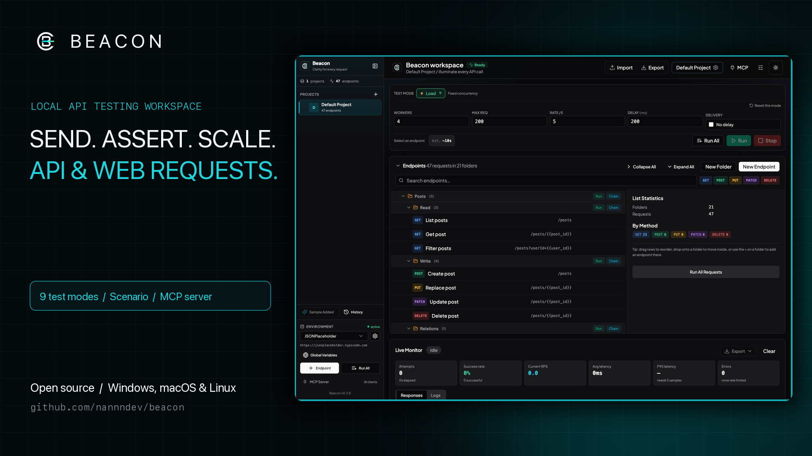
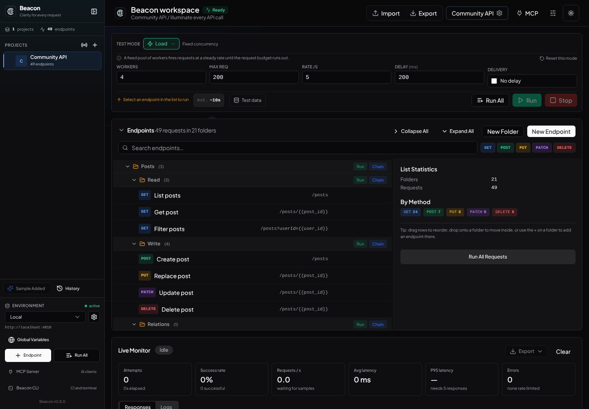
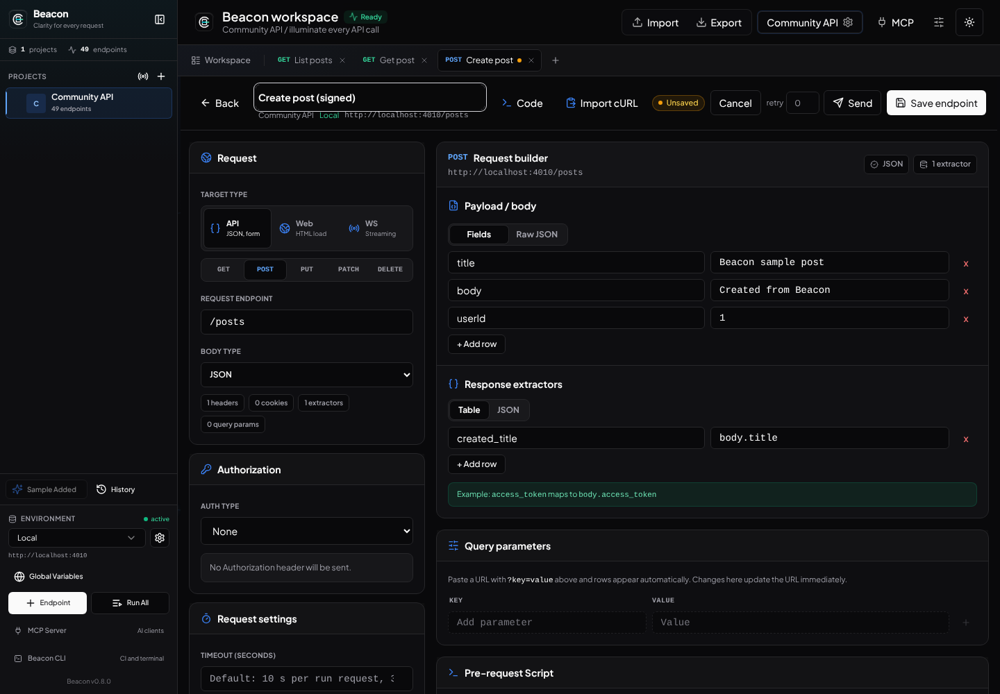
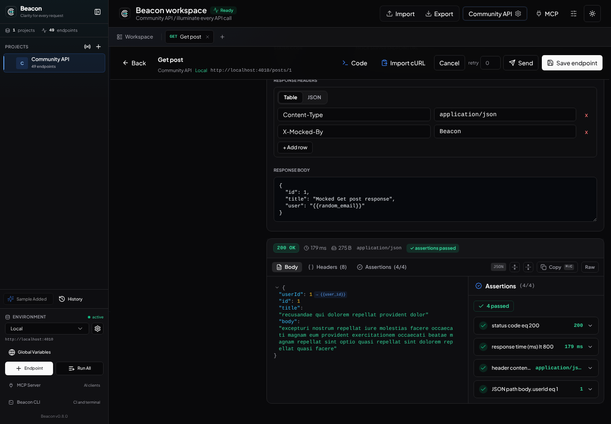
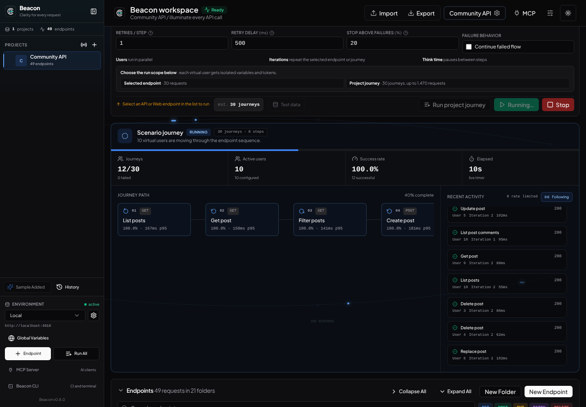
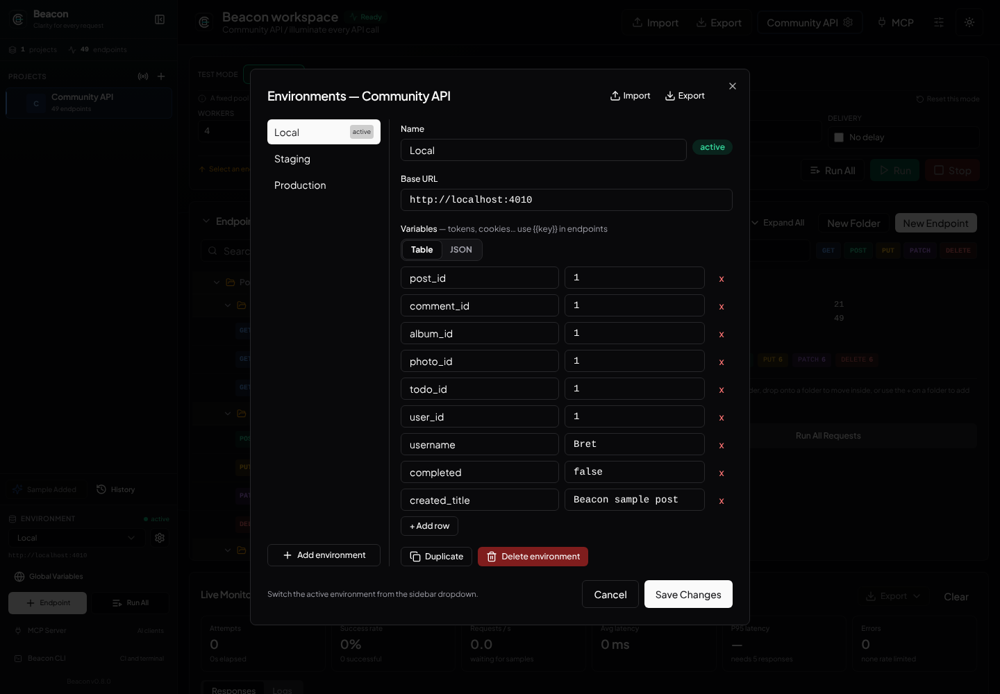
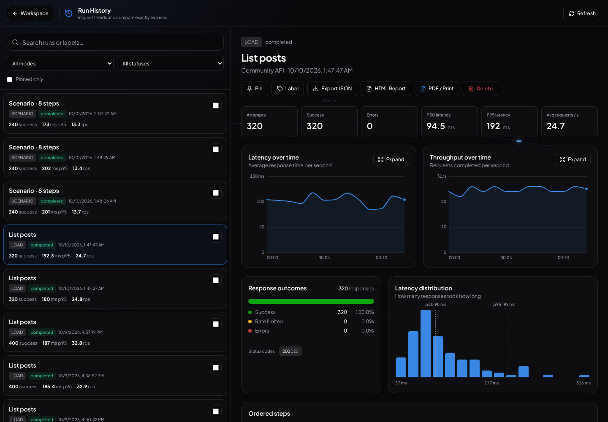
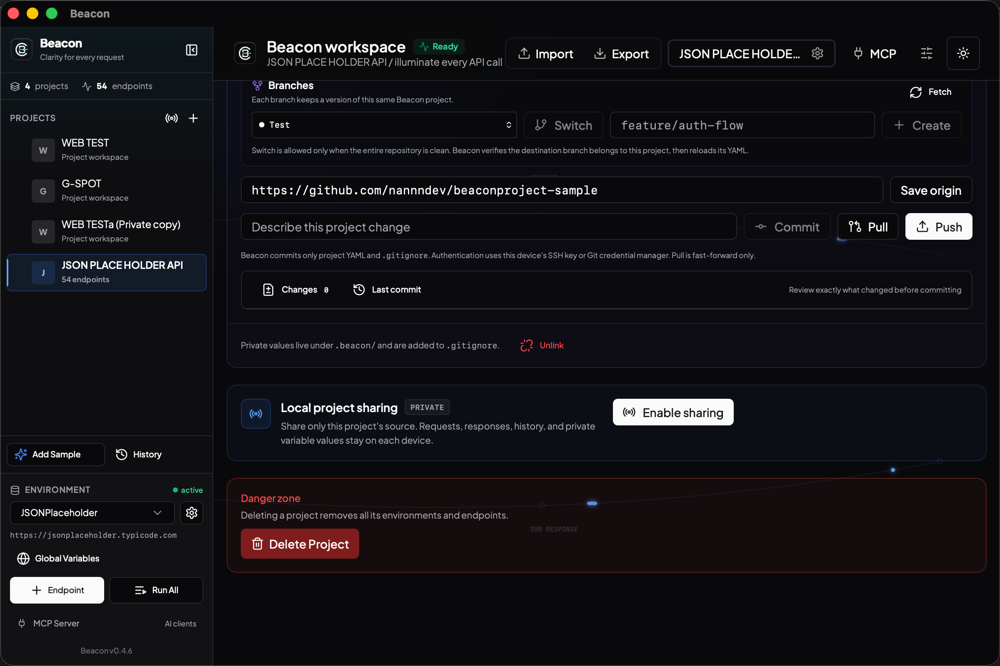

# Beacon

**Beacon** is a modern API workspace for building requests, chaining API flows, validating responses, and running authorized load and rate-limit tests.

Built with **Rust** (`beacon-core`, `beacon-server`, `beacon-gateway`, `beacon-agent`, `beacon-mcp`, `beacon-cli`), **React**, **TypeScript**, **Vite**, **shadcn/ui**, and **Tauri v2** for macOS, Windows, and Linux — with no Python runtime required.



## Install

### macOS (Homebrew)

```bash
brew install --cask nannndev/tap/beacon
```

Or via one-liner shell installer (copies `Beacon.app` to `/Applications` and links the `beacon` CLI):

```bash
curl -fsSL https://raw.githubusercontent.com/nannndev/beacon/main/scripts/install.sh | bash
```

### Windows (Scoop / PowerShell)

```powershell
scoop bucket add nannndev https://github.com/nannndev/scoop-bucket
scoop install beacon
```

Or via PowerShell:

```powershell
irm https://raw.githubusercontent.com/nannndev/beacon/main/scripts/install.ps1 | iex
```

### Linux (`AppImage` / `.deb`)

```bash
# Portable AppImage (no root required)
curl -fsSL https://raw.githubusercontent.com/nannndev/beacon/main/scripts/install.sh | bash

# Debian / Ubuntu (.deb)
curl -fsSL https://raw.githubusercontent.com/nannndev/beacon/main/scripts/install.sh | bash -s -- --deb
```

Direct installers (`.dmg`, `.exe`, `.AppImage`, `.deb`) are also published on [GitHub Releases](https://github.com/nannndev/beacon/releases).

## Product Preview

### Organized API workspace

Manage multiple projects and environments, group endpoints in nested folders, select a test mode, and monitor runs from one workspace.



### Dynamic request builder

Build JSON, form, multipart, or raw requests with environment variables, generated values, authentication helpers, headers, cookies, and response extractors. Per-request transport controls (timeout, redirects, TLS verification, proxy) and CSV/JSON test data let one endpoint cover many cases.



### Send and inspect a response

Send a single request before starting a load test. Inspect status, latency, size, headers, parsed JSON, extracted variables, and assertion results. JSON fields can be promoted to extractors directly from the response.


### Assertions and scenarios

Attach pass/fail rules to an endpoint, then run a selected API or Web request with virtual users or chain the full project in order. Extracted values carry into later steps, with retry and continue-on-error controls for chained flows.





### Projects and environments

Keep base URLs and variables separate across development, staging, and other environments without duplicating endpoint definitions.



### Local run history

Search, filter, pin, inspect, export, and compare saved runs. Each run keeps latency-over-time and throughput charts, a latency-distribution histogram, and outcome breakdowns. History stays local and keeps completed evidence available after the live monitor is cleared.



### Git-backed projects

Store a Beacon project as readable YAML, review its changed files, and use Git without leaving the desktop app. Beacon can initialize or clone a repository, commit project changes, pull and push, fetch branches, compare them before switching, and import API definitions discovered in a non-Beacon repository.

Private environment values remain under the ignored `.beacon/` directory. Responses, run history, logs, and generated runtime values stay on the device that executes the request.



## Features

- Project workspaces with nested, draggable request folders
- Ready-to-run JSONPlaceholder sample with 47 organized CRUD, filter, and relation requests
- Environment and global variables using `{{variable}}` templates
- Fresh-per-request generators such as `{{random_email}}`, `{{uuid}}`, `{{timestamp}}`, and `{{random_string:12}}`
- Postman collection import and redacted project export
- Beacon, Postman, OpenAPI, Swagger, Insomnia, HAR, JSON, and YAML import from a file, pasted content, folder, or Git repository
- Readable Git-backed project files with status, diff review, commit, fast-forward pull, and push
- Branch fetch, creation, comparison, and guarded switching for the same Beacon project
- JSON, form, multipart, and raw request bodies
- Web Page targets for HTML document load testing, redirects, TTFB, and throughput
- Per-endpoint authentication, headers, cookies, extractors, and run overrides
- Per-request transport controls: timeout, redirect following, TLS verification, and proxy
- Data-driven runs that feed each request or scenario journey a row from a CSV or JSON file, with every column available as a `{{column}}` variable
- Tabbed endpoint editor that keeps unsaved drafts, with an unsaved-change guard and a save shortcut
- Single Send with a structured Response Inspector and click-to-extract JSON fields
- Assertions for status, response time, body content, JSON fields, and headers
- Ordered scenarios with extractor-based state chaining, isolated virtual users, iterations, ramp-up, think time, retries, and per-step bottleneck metrics
- Load, Ramp, Spike, Soak, Rate Probe, Capacity, Fuzz, Benchmark, Scenario, and WebSocket test modes, each with a one-line behaviour summary (Fuzz exposes selectable injection types)
- Live Monitor with honest per-second throughput, response-time and error-rate charts, a p95 reference, response logs, and exportable results
- Local Run History with pinning, filters, expandable charts, a latency-distribution histogram, and semantic two-run comparison
- Native desktop app via Tauri v2 with bundled Rust backend, CLI, and MCP sidecars
- Built-in **Beacon AI Copilot** drawer with live activity states, character/vibe presets, custom `SKILL.md` playbooks, and multi-step tool execution across projects
- Headless CLI (`beacon`) for endpoint, folder, and full-project checks with JSON/JUnit reports and CI exit codes
- Standard MCP server (`beacon-mcp`) for Claude, Cursor, Windsurf, Cline, Continue, Antigravity, and other MCP clients
- Unified **AI Gateway**: OpenAI- and Anthropic-compatible local proxy supporting 21 API-key providers and 8 OAuth subscription providers (Claude, ChatGPT/Codex, GitHub Copilot, Gemini CLI, Kimi, etc.), encrypted vault (`gateway.db`), fallback combos, and usage logs

## Development Quick Start

### Prerequisites

- **Rust** toolchain (`cargo`, `rustc`)
- **Node.js** + **pnpm**

### Start the backend & frontend

```bash
# Terminal 1 — Rust Axum backend (port 8000)
cargo run -p beacon-server --release

# Terminal 2 — React + Vite frontend (port 5173)
cd frontend
pnpm install
pnpm run dev
```

### Run Tauri desktop app locally

```bash
cd frontend
pnpm run desktop:build
```

### Run tests

```bash
cargo test --workspace
```

On a fresh install, Beacon opens a conservative JSONPlaceholder sample project
with six resource folders and 47 requests. Existing workspaces are never
replaced; use **Add Sample Project** in the sidebar to add or reopen it.

## MCP Server

Beacon includes a standard stdio MCP server that can list and manage projects, folders, and endpoints; import collections; send individual requests; and run endpoints or chained scenarios.

In the desktop app, open **MCP Server** to register Beacon with a supported client or copy a ready-to-use configuration. See [MCP Server documentation](./docs/mcp.md) for setup and the available tools.

## Agent Skill (skills.sh)

[](https://skills.sh/nannndev/beacon)

Beacon includes an official agent skill (`SKILL.md`) for AI coding agents like Claude Code, Cursor, Windsurf, GitHub Copilot, and Antigravity. Install it directly with:

```bash
npx skills add nannndev/beacon
```

## Beacon CLI

Desktop releases include a standalone `beacon` command for running the same Git-backed project files without opening the app or installing Python:

```bash
beacon validate ./api-tests --env CI
beacon run ./api-tests --env CI --bail --github \
  --report-junit api-tests/reports/beacon.xml
beacon ci init github ./api-tests
```

Run a complete project, one folder, or selected endpoints, or generate a ready-to-review GitHub Actions workflow. Assertions and extractors use the same engine as the desktop app; private values can be supplied with `BEACON_VAR_*`, an ignored env file, or `--env-var`. See the [CLI tutorial](./docs/cli/index.md), [GitHub Actions guide](./docs/cli/github-actions.md), and [command reference](./docs/cli/reference.md).

## Documentation

The full VitePress documentation lives in [`docs/`](./docs/index.md).

For team workflows, see [Git-backed projects](./docs/features/git-backed-projects.md) and [local project sharing](./docs/superpowers/specs/2026-07-25-local-project-sharing-design.md).

```bash
pnpm run dev:docs
pnpm run docs:build
pnpm run docs:preview
```

## Security

Use Beacon only against systems you own or are explicitly authorized to test. Local configuration can contain live URLs, cookies, bearer tokens, and other credentials; `config/tests.json` is ignored by Git and must remain private.

## License

Beacon is open-source software licensed under the [MIT License](./LICENSE).
